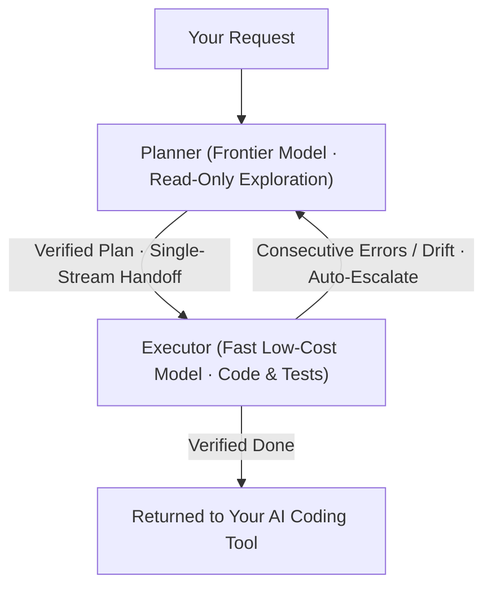

English | [简体中文](./README.zh-CN.md)

# InnerHop

**Give any AI coding harness a stateful "Frontier Planner + Fast Executor" dual-model orchestration loop — without changing your workflow.**

Keep using **Claude Code, Codex CLI, OpenCode, Cline, Roo Code, Cursor, or Aider**. Point your client to the local `InnerHop` proxy (`127.0.0.1:8787`), and every session automatically runs:



---

## Real-World Benchmark

In a live end-to-end build & verification task pairing **`gpt-6.2-astra` (read-only architecture + review)** with **`deepseek-flash` (coding + self-verification)**:
- **83% lower cost** compared to running `gpt-6.2-astra` end-to-end across all turns;
- Planner stays strictly read-only while exploring the codebase and drafting the plan, then hands off seamlessly inside the same SSE stream to the low-cost Executor — escalating back automatically if the Executor hits consecutive errors.

---

## Key Features

- **4-Tab Bilingual Desktop App (`EN / 中文`)**: Clean navigation (`Home · Console` → `API Keys` → `Strategies` → `Live Cockpit`) with system tray background execution and clean port release on quit.
- **Direct Home Control & Reasoning Effort**: Pick preset strategies or freely pair any vendor, model, and **5-level Reasoning Effort (`Default / Low / Medium / High / Extra High`)** directly from the console.
- **Non-Intrusive Smart-Split Routing**: Multi-select routing table lets you pick exactly which client model keywords trigger InnerHop while all other models pass straight through to official APIs untouched.
- **Cross-Vendor & Multi-Protocol Translation**: Frontend harnesses and backend API providers are decoupled. Automatically adapts **OpenAI `/v1/responses`**, **Anthropic Adaptive Thinking & signed thinking blocks**, **DeepSeek `reasoning_content`**, and **Google Gemini `thought_signature`** across heterogeneous handoffs.

---

## Quick Start

### Option 1: Desktop App (Windows / macOS / Linux)

1. Download the release package for your OS from [GitHub Releases](https://github.com/EasonMWS/innerhop/releases) (or build locally — see below).
   - **Windows**: Extract `InnerHop-0.2.1-win.zip` and launch `InnerHop.exe`.
   - **Linux**: Extract `InnerHop-0.2.1-linux-x64.tar.gz` and run `./innerhop` (or build `.AppImage` / `.tar.gz` locally via `pnpm desktop:pack:linux`).
   - **macOS**: Build locally on macOS via `pnpm desktop:pack:mac` (outputs Apple Silicon & Intel `.dmg` / `.zip`).
2. Open **API Keys** in the left sidebar, paste your official developer API keys, and click **Test Key**.
3. Go to **Home · Console**, choose a strategy or manually select your Planner, Executor, and Reasoning Effort.
4. Connect your AI coding harness below and continue coding in your native tool.

### Option 2: CLI (`innerhop` / `ih`)

```bash
# Launch a tool with ephemeral proxy env vars (does not touch global configs)
innerhop run claude
innerhop run codex
innerhop run opencode
innerhop run aider

# Or run the standalone local daemon
innerhop serve --port 8787
innerhop status
```

---

## Supported Harnesses

> **Frontend vs. Backend Decoupling**: Connecting a harness only controls which coding client enters InnerHop — it works with **any** backend API provider you configure (e.g., Codex CLI or OpenCode can seamlessly dispatch Claude, Gemini, or DeepSeek models).
>
> **CLI vs. Consumer Desktop Apps**: One-click `Claude Code` and `OpenAI Codex CLI` integrations work strictly with **terminal CLIs (API Key mode)**. Official consumer OAuth desktop apps (**Claude Desktop** and **ChatGPT / Codex Desktop**) ignore third-party base URLs and remain unproxied. If you want a visual GUI client, use **VS Code / Cursor + Cline / Roo Code** or **OpenCode**.

| Harness | Integration | Routing Behavior |
| :--- | :--- | :--- |
| **OpenCode** (`Desktop + CLI`) | One-click toggle (backups & updates `~/.config/opencode/opencode.json`) | Injects `innerhop` (follows active Home choice) plus pinned `ih:<strategy-id>` aliases while preserving existing providers. |
| **DeepSeek Harness / DSH** (`Desktop + Web + CLI`) | One-click toggle (backups & updates `~/.dsh/profiles/*/cordis.patch.yml` & `.credentials.yaml`, or legacy `settings.yaml`) | Injects `innerhop` OpenAI-compatible provider + strategy aliases and sets default model automatically (restart DSH Desktop if already open). |
| **Claude Code CLI** (`CLI Only`) | One-click toggle (auto-backups `~/.claude/settings.json` and restores byte-for-byte) | Terminal CLI (API Key mode) only; Claude Desktop consumer app ignores `ANTHROPIC_BASE_URL`. Smart-Split intercepts only checked slots (`opus`, `opusplan`, etc.). |
| **OpenAI Codex CLI** (`CLI Only`) | One-click toggle (appends isolated `[profiles.innerhop]` to `~/.codex/config.toml`) | Terminal CLI (`codex -p innerhop` + `OPENAI_API_KEY`) only; official ChatGPT / Codex Desktop consumer app stays untouched and unproxied. |
| **Aider CLI** (`CLI Only`) | One-click toggle (appends managed block to `~/.aider.conf.yml` with backup/restore) | Sets `openai-api-base`, placeholder key, and `model: openai/innerhop` (follows active Home configuration); or run `innerhop run aider`. |
| **Other Harnesses (Cline / Roo Code / Cursor / Windsurf)** (`IDE / GUI`) | Click **Setup Guide** in the unified card | Set Provider to `OpenAI Compatible`, Base URL `http://127.0.0.1:8787/v1`, any placeholder API Key (`innerhop-local`), and Model `innerhop` (or `ih:<id>`). |

---

## Recommended Model Pairings

| Use Case | Planner | Executor | Reasoning Effort | Notes |
| :--- | :--- | :--- | :--- | :--- |
| **Cross-Vendor Cost Saver (83% Cheaper)** | `gpt-6.2-astra` / `claude-opus-5-5` | `deepseek-flash` / `gemini-4-hydrogen` | Planner `High` · Executor `Low` | Frontier planning + ultra-low-cost execution |
| **OpenAI Flagship Stack** | `gpt-6.2-astra` | `gpt-6.2-sol` | Planner `High` · Executor `Low/Med` | Long-horizon engineering & reliable tool calls |
| **Anthropic Native Stack** | `claude-opus-5-5` / `claude-fable-5-2` | `claude-sonnet-5-5` | Planner `High` · Executor `Low` | Large refactors & architecture design |
| **100% Local & Free** | `deepseek-pro` or local model | Ollama `qwen3-coder:14b` | `Default` | Air-gapped / zero API spend |

---

## Compliance & Local Security

1. **Developer API Keys & Local Models Only**: Consumer subscriptions (ChatGPT Plus/Pro, Claude Pro/Max) prohibit third-party OAuth proxying. InnerHop **only** uses official developer API keys or local Ollama, and explicitly rejects consumer session headers (`chatgpt-account-id`) with HTTP `403`.
2. **ChatGPT Pro Promotional API Credit Boundary**: OpenAI terms exclude using ChatGPT Pro monthly promotional API credits with Codex via API keys. Use non-Codex harnesses (e.g., OpenCode / Cline) if spending promotional credits, or use a separate pay-as-you-go API key with Codex CLI.
3. **Strict Local Threat Model**:
   - Binds strictly to `127.0.0.1` loopback by default (`INNERHOP_ALLOW_REMOTE=1` required otherwise);
   - Management endpoints (`/api/*`) enforce strict browser `Origin` checks against CSRF;
   - API keys stay exclusively on disk at `~/.innerhop/config.json` (with automatic non-destructive migration from legacy `~/.orchestrator/` if present). See [SECURITY.md](./SECURITY.md).

---

## Local Development & Packaging

Requirements: Node.js `>= 20`, `pnpm >= 10`.

```bash
# Install dependencies
pnpm install

# Run full test suite (FSM, security guards, cross-protocol E2E)
pnpm test

# Workspace typecheck & build
pnpm typecheck
pnpm build

# Desktop app dev mode
pnpm desktop:dev

# Package installers per platform (outputs to packages/desktop/release/)
pnpm desktop:pack          # Windows (.exe + .zip)
pnpm desktop:pack:mac      # macOS (.dmg + .zip, run on macOS)
pnpm desktop:pack:linux    # Linux (.AppImage + .tar.gz)
```

## License

[MIT](./LICENSE)
