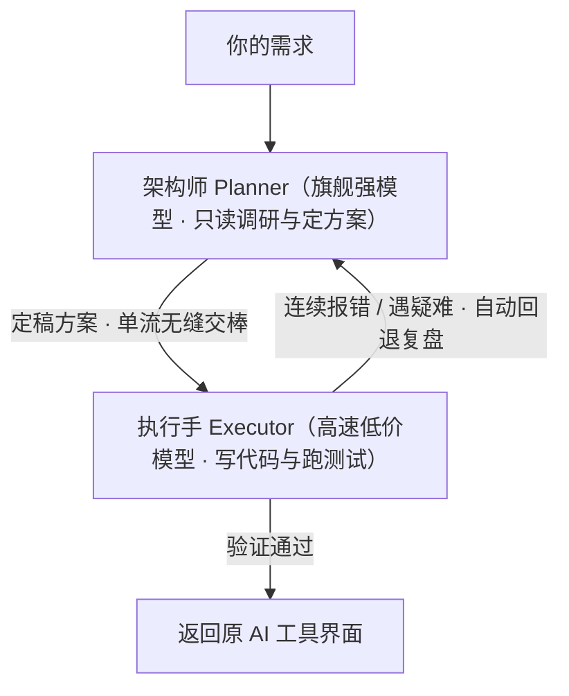

[English](./README.md) | 简体中文

# InnerHop

**给任意 AI 编程工具装上「强模型定方案 + 快模型写代码」的通用双模型本地调度器。**

不用换掉你习惯的 **Claude Code、Codex CLI、OpenCode、Cline、Roo Code、Cursor、Aider**，只要连上本地 `InnerHop` 引擎，就能在同一个对话内自动完成：



---

## 实测效果

在真实离线应用开发与多轮工具验证测试中，采用 **`gpt-6.2-astra`（只读架构与验收） + `deepseek-flash`（写代码与自测落地）** 跨厂商混搭：
- 相比全程使用旗舰模型 `gpt-6.2-astra`，**单任务实测节省 83% 模型费用**；
- 架构师先锁定只读查清项目结构并输出方案，再无缝交棒低价高并发执行手落地改码，执行遇卡壳自动交回架构师复盘。

---

## 核心特性

- **清晰四栏双语工作台（中文 / EN）**：支持系统语言自动识别与一键切换，左侧按顺序引导配置——`首页 · 控制台` / `模型 API Key` / `编排策略` / `实时驾驶舱`（含每轮分工明细、双模型 Token 账单与省钱统计），支持系统托盘后台常驻及右键彻底退出。
- **首页直接自由混搭**：一键切换预设策略，或直接手动选择任意厂商、模型与 **5 档思考强度（默认 / 低 / 中 / 高 / 极高）**，不命中预设策略自动切为「自定义」。
- **默认智能分流，不劫持原工具**：在「智能分流（推荐）」下通过勾选表精确控制哪些客户端模型进编排引擎，其他模型 100% 原样直通官方接口。
- **前后台完全解耦，全厂商协议兼容**：接入的工具（入口）与后台 API 模型（大脑）互相独立；自动完成 OpenAI `/v1/responses`、Anthropic 自适应思考与签名保护、DeepSeek `reasoning_content`、Google Gemini `thought_signature` 跨协议适配。

---

## 快速上手

### 方式一：桌面端（Windows / macOS / Linux）

1. 前往 [GitHub Releases](https://github.com/EasonMWS/innerhop/releases) 下载对应系统安装包（或参考文末命令本地打包）：
   - **Windows**：解压 `InnerHop-0.2.0-win.zip` 并运行 `InnerHop.exe`，后台自动在 `http://127.0.0.1:8787` 启动本地引擎。
   - **Linux**：解压 `InnerHop-0.2.0-linux-x64.tar.gz` 并运行 `./innerhop`，或在本机运行 `pnpm desktop:pack:linux` 生成 `.AppImage`/`.tar.gz`。
   - **macOS**：克隆仓库后在 macOS 下运行 `pnpm desktop:pack:mac`（生成 Apple Silicon & Intel `.dmg`/`.zip`）。
2. 点左侧 **「模型 API Key」**，填入你的官方开发者 API Key 并点 **「测速验 Key」**。
3. 回到 **「首页 · 控制台」**，在「当前工作模式」选好预设策略或手动搭配模型与思考强度。
4. 在下方「一键接入我的 AI 编程工具」接入你常用的工具，然后回原工具对话即可。

### 方式二：命令行 CLI（`innerhop` / `ih`）

```bash
# 仅对当前终端会话注入本地代理地址，不改动本机全局配置
innerhop run claude
innerhop run codex
innerhop run opencode
innerhop run aider

# 或后台启动本地服务与查看状态
innerhop serve --port 8787
innerhop status
```

---

## 各端 AI 工具接入说明

> 提示：下表仅配置「哪个前台工具连入本地引擎」，与你后台选哪家模型无关（例如用 OpenCode / Codex CLI / 其他 Harness 一样可以调用 Claude / DeepSeek / Gemini 模型）。

| 工具 | 接入方式 | 路由与使用说明 |
| :--- | :--- | :--- |
| **Claude Code** | 首页点 **「一键接入」**（自动备份 `~/.claude/settings.json`，关闭即 100% 还原） | 智能分流默认仅接管选中的触发关键词（如 `opus` / `opusplan`）；选其他原生模型时直接透传官方 API。 |
| **Codex CLI** | 首页点 **「一键接入」**（自动备份 `~/.codex/config.toml`） | 在配置末尾写入独立 `[profiles.innerhop]`，**不影响官方 Codex/ChatGPT 桌面端**；终端执行 `codex -p innerhop` 使用。 |
| **OpenCode** | 首页点 **「一键接入」**（自动备份 `~/.config/opencode/opencode.json`） | 自动注入动态别名 `innerhop` 及全部预设策略 `ih:<策略id>`，保留原有供应商配置。 |
| **其他 Harness（Cline / Roo Code / Cursor / Aider 等）** | 首页 **「其他 Harness」** 点 **「查看 3 步配置」** | Provider 选 `OpenAI Compatible`，Base URL 填 `http://127.0.0.1:8787/v1`，API Key 填任意占位字符（如 `innerhop-local`），Model 填 `innerhop`（跟随当前工作模式）或 `ih:<策略id>`（锁定某条策略）。 |

---

## 模型搭配建议

| 场景 | 架构师（Planner） | 执行手（Executor） | 推荐思考强度 | 适用说明 |
| :--- | :--- | :--- | :--- | :--- |
| **跨厂商高性价比（实测省 83%）** | `gpt-6.2-astra` / `claude-opus-5-5` | `deepseek-flash` / `gemini-4-hydrogen` | 架构师 `高` · 执行手 `低/默认` | 强推理定方案（消耗极少）+ 超低价高速模型写代码与修测试 |
| **OpenAI 旗舰全栈** | `gpt-6.2-astra` | `gpt-6.2-sol` | 架构师 `高` · 执行手 `低/中` | 长程工程设计与稳定工具调用 |
| **Anthropic 原生主力** | `claude-opus-5-5` / `claude-fable-5-2` | `claude-sonnet-5-5` | 架构师 `高` · 执行手 `低` | 重度代码重构与架构演进 |
| **本地零费用** | `deepseek-pro` 或本地大模型 | Ollama `qwen3-coder:14b` | `默认` | 隐私敏感或离线轻量开发 |

---

## 账号合规与本地安全

1. **仅支持开发者 API Key 与本地 Ollama**：严禁将消费级订阅（ChatGPT Plus/Pro、Claude Pro/Max）通过第三方代理转发或与 API 混用。本软件底层直接拦截含 `chatgpt-account-id` 等消费级会话凭据的请求并返回 `403`。
2. **OpenAI Pro 赠金边界提示**：若你的 OpenAI API Key 关联了 ChatGPT Pro 每月赠送的 API 额度，按 OpenAI 条款该额度仅可用于开发者自建工具/第三方 Agent（如 OpenCode / Cline 等），禁止接入 Codex CLI。
3. **绝对本地化安全边界**：
   - 默认严格绑定 `127.0.0.1` 回环地址，拒绝外网监听（如需覆盖需显式设置 `INNERHOP_ALLOW_REMOTE=1`）；
   - 管理接口 `/api/*` 校验浏览器 `Origin`，防止恶意网页窃取本地配置；
   - 全部 API Key 仅保存于用户本机 `~/.innerhop/config.json`（若存在旧版 `~/.orchestrator/` 配置将自动无损只读迁移，代码仓库与打包产物零硬编码凭证），详见 [SECURITY.md](./SECURITY.md)。

---

## 本地开发与跨平台打包

环境要求：Node.js `>= 20`，`pnpm >= 10`。

```bash
# 安装依赖
pnpm install

# 运行全部测试（FSM、安全边界、跨协议端到端测试）
pnpm test

# 全工作区类型检查与构建
pnpm typecheck
pnpm build

# 启动桌面端开发模式
pnpm desktop:dev

# 各平台打包（产物输出至 packages/desktop/release/）
pnpm desktop:pack          # Windows (.exe + .zip)
pnpm desktop:pack:mac      # macOS (.dmg + .zip，需在 macOS 下运行)
pnpm desktop:pack:linux    # Linux (.AppImage + .tar.gz)
```

## License

[MIT](./LICENSE)
